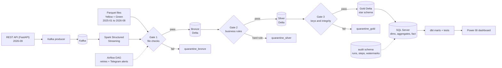
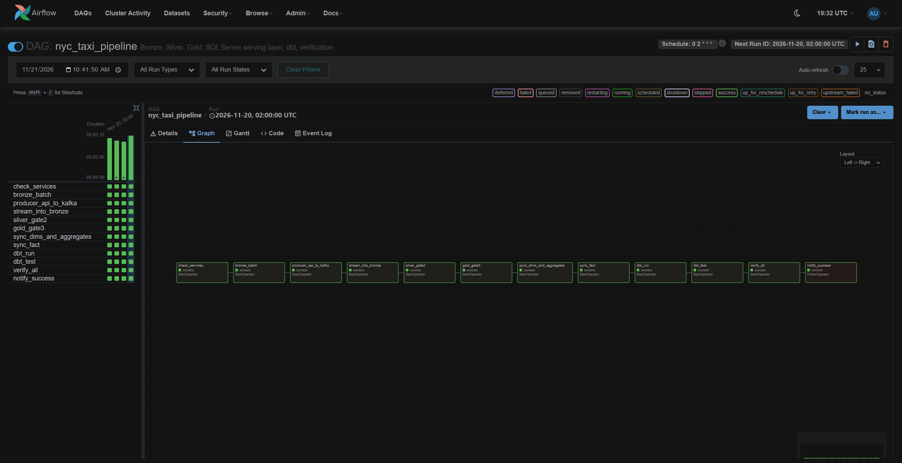

# NYC Taxi Full Data Engineering (Data Pill)

An end-to-end data engineering project on **NYC TLC Yellow and Green taxi trips (January 2025 to September 2026)**.
It ingests 83.3 million trips from files and from a live-style REST API and Kafka stream, cleans them through
three quality gates (Bronze, Silver, Gold), loads a star schema into SQL Server, tests it with dbt, and serves
a Power BI dashboard. Airflow runs the whole flow with retries and Telegram alerts.

Author: Abdallah Ali Abdelgawad. Graduation project for the Data Pill program.

---

## 1. The problem

Taxi trip data is large, messy and arrives in more than one way. This project answers three business questions
from it, and proves every number on the way:

| # | Business question |
|---|---|
| Q1 | **When and where is taxi demand highest?** (hour, weekday, borough, zone) |
| Q2 | **How do payment types and tips differ?** (card tips are recorded, cash tips are not) |
| Q3 | **How do revenue and average fare change over time for Yellow and Green, and what does the new congestion fee (CBD) add?** |

## 2. Architecture



**Streaming and batch together.** The last month (2026-09, 3.9 million trips) enters through the live path
(API, Kafka, Spark Structured Streaming). All earlier months enter as files. Both paths write into the same Bronze
tables. Silver and Gold are incremental batch jobs: they read only the rows that are new since the last run.

## 3. Data sources and volume

| Source | Type | Content | Rows |
|---|---|---|---|
| TLC monthly Parquet files (Yellow, Green) | Files (batch) | 2025-01 to 2026-08 | 79,354,446 |
| FastAPI "dispatch" API, then Kafka | REST API and stream | 2026-09 | 3,922,720 |
| `taxi_zone_lookup.csv` | File | 265 taxi zones | 265 |
| **Total trips** | | | **83,277,166** |

Official data dictionaries are in `docs/` (Yellow and Green). Two columns are not in them: `ehail_fee` (100% empty)
and `request_source` (appears from 2026-06). We keep them as they are and do not guess their meaning.

## 4. Technology and why

The full reasoning, with the alternatives we compared, is in [`docs/decisions.md`](docs/decisions.md).

| Area | Tool | Short reason |
|---|---|---|
| Processing | **PySpark 3.5** | Distributed engine for 80+ million rows, native Delta Lake, real streaming |
| Lakehouse | **Delta Lake 3.2** on local disk (ADLS Gen2 ready) | ACID writes, schema evolution, time travel |
| Streaming | **Kafka (KRaft)** + **Spark Structured Streaming** | Second source type and real streaming |
| Source API | **FastAPI** | Simulates a live dispatch system |
| Warehouse and serving | **SQL Server 2022 (Developer)** | Required warehouse. Columnstore for the 83 million row fact |
| Transformations and tests | **dbt** (`dbt-sqlserver`) | Marts as views and automated data tests |
| Orchestration | **Airflow 2.11** | DAG with dependencies, retries and failure alerts |
| Alerts | **Telegram bot** | Instant failure and success messages |
| Dashboard | **Power BI** | Reads the dbt marts |
| Exploration | **PyArrow, DuckDB** | Fast profiling of 83 million rows without a cluster |
| Infrastructure | **Docker Compose** | One image for all jobs |
| Quality of code | **pytest**, **GitHub Actions** | 21 unit tests run on every push |

## 5. Medallion layers and the three quality gates

| Layer | What it holds | Gate | A row or file that fails goes to |
|---|---|---|---|
| **Bronze** | Raw columns as they came, plus `taxi_type`, `source_file`, `ingestion_timestamp` | **Gate 1**: file can be read, mandatory columns exist, file not empty (for stream messages: valid JSON with pickup and dropoff time) | `quarantine_bronze` (with the reason) |
| **Silver** | Yellow and Green in one schema, lowercase names, calculated columns, `trip_id`, duplicates removed | **Gate 2**: hard rules (impossible values) quarantine the row. Soft rules (unusual values) only add a flag | `quarantine_silver` (with the reason) |
| **Gold** | Star schema: `fact_trips` and 4 dimensions, plus 2 aggregates | **Gate 3**: every key must exist in its dimension, `trip_id` not empty, unique | `quarantine_gold` |

Gate 2 hard rules (limits come from the profiling, not from guesses; see `config/rules.yml`): dropoff before
pickup, pickup outside 2025-01-01 to 2026-09-30, duration over 24 hours, passengers over 6, distance over 100 miles,
fare over 1,000 dollars, speed over 100 mph, `total_amount` empty. Soft rules (flag only): zero distance, zero
passengers, long or very short trips, fares over 300 dollars, negative amounts, cash with a tip, CBD fee before
its start date, airport fee outside an airport zone, and more.

Important finding from profiling: about 25% of Yellow trips are **Flex Fare** trips (payment type 0). Five columns are
always empty in them. This is a recording pattern, so it is not flagged. Negative amounts (3.7% of Yellow) are kept
and flagged, because they are tied to disputes and no-charge trips.

Full rules and the reason for every limit: the Data Dictionary and Quality Rules document.

## 6. Data model

Star schema with `fact_trips` in the center and four dimensions (`dim_date`, `dim_location`, `dim_payment`,
`dim_taxi_type`). Diagram: [`docs/erd_star_schema.md`](docs/erd_star_schema.md). Every table and column is explained in
the Serving Layer and Gold Model document.

## 7. Orchestration, monitoring and alerts

* **Airflow DAG `nyc_taxi_pipeline`**: 12 tasks in a line:
  `check_services, bronze_batch, producer_api_to_kafka, stream_into_bronze, silver_gate2, gold_gate3,
  sync_dims_and_aggregates, sync_fact, dbt_run, dbt_test, verify_all, notify_success`.
  Each task has 2 retries (2 minutes apart), a 3-hour timeout and a failure alert. No manual step is needed.
* **Logging**: every job writes structured log lines (`event=... key=value`).
* **Audit schema in SQL Server**: `audit.pipeline_runs` (one row per run), `audit.step_logs` (rows read, accepted,
  quarantined, seconds, status for every file or slice), `audit.watermarks` (how far each layer has read).
* **Alerts**: Telegram message on failure and on success. A DAG `telegram_alert_test` fails on purpose to show it.
* **Reconciliation**: `verify_all.py` runs 40 checks. Kafka, Bronze, Silver, Gold and SQL Server must agree row by row,
  and money must match between the lakehouse and SQL Server.

## 8. Serving layer and dashboard

Gold lives in the lakehouse. SQL Server holds the dimensions, the two aggregates and the full fact table
(about 3.65 GB as a clustered columnstore). dbt builds four views in schema `dbo_marts`
(`mart_demand_hourly`, `mart_demand_by_zone`, `mart_payment_tips`, `mart_revenue_monthly`). Power BI reads those views.
See the Serving Layer and Gold Model document for the columns and the definition of every measure.




## 9. Testing and CI

* `pytest`: 21 unit tests for the transformation functions (unify, calculated columns, Gate 1, Gate 2, Gate 3,
  date dimension). Run: `docker compose run --rm spark sh -c "pip install -q pytest && python -m pytest tests -v"`.
* `dbt test`: 28 data tests defined (unique, not null, relationships, accepted values, ranges). The 21 on the dimensions
  and aggregates run in the DAG. The 7 on the 83-million-row fact are tagged `heavy` and run on demand.
* GitHub Actions (`.github/workflows/ci.yml`): installs Spark and runs the unit tests on every push.

## 10. How to run

**Requirements**: Windows 11, Docker Desktop (WSL2, at least 20 GB for Docker), SQL Server 2022 with SQL
authentication and TCP port 1433, Python 3.11, Git, Microsoft ODBC Driver 18, the TLC files downloaded to one folder
(`yellow/`, `green/`, `lookup/`).

1. Clone the repository and copy `.env.example` to `.env`. Fill in the paths, the SQL Server password and
   (optional) the Telegram token and chat id. `.env` is never committed.
2. In SQL Server run, in this order: `sql/00_setup_database.sql` (and create the login by hand),
   `sql/01_create_audit_schema.sql`, `sql/02_create_watermarks.sql`, `sql/03_create_gold_schema.sql`,
   `sql/03b_create_gold_aggregates.sql`, `sql/04_create_fact.sql`. Run `sql/05_add_fact_foreign_keys.sql`
   after the first full load.
3. Create the Python environment for dbt: `python -m venv venv`, activate it, `pip install -r requirements.txt`.
4. Build and start: `docker compose build` then `docker compose up -d kafka api airflow`.
5. **Run everything with one command**: `.\run_pipeline.ps1`
   (or open Airflow at http://localhost:8081 and trigger `nyc_taxi_pipeline`).
   `.\run_pipeline.ps1 -Reset` wipes the lakehouse and rebuilds from zero.
6. Check: `docker compose run --rm spark python -u src/jobs/verify_all.py` (expects 40 of 40 checks to pass).
7. Power BI: connect to SQL Server, database `nyc_taxi_dw`, and import the four views of `dbo_marts`.

Secrets live only in `.env` (and Airflow reads them as environment variables). Nothing secret is in the code.

## 11. Results (measured)

| Layer | Rows |
|---|---|
| Bronze (batch + stream) | 83,277,166 (Yellow 82,302,001, Green 975,165) |
| Silver | 83,246,926 |
| `quarantine_silver` | 30,232 (0.036% of rows) |
| Exact duplicates removed | 8 |
| Gold `fact_trips` | 83,246,926 (Silver = Gold + 0 quarantined) |
| SQL Server `gold.fact_trips` | 83,246,926 |
| Aggregates | 602,330 (daily) and 30,594 (hourly) |

Bronze = Silver + quarantine + duplicates holds exactly: 83,277,166 = 83,246,926 + 30,232 + 8. Every
quarantine reason count matches the profiling counts exactly.

## 12. Performance and cost

| What | Measurement |
|---|---|
| First Bronze batch load (42 files, 79.35 million rows) | about 154 seconds |
| Bronze re-run with nothing new (incremental skip) | about 16 seconds |
| Silver full build (33 slices Yellow, 21 Green) | about 33 minutes; about 70 seconds per monthly Yellow slice |
| Fact table to SQL Server | about 2.5 minutes per month, about 50 minutes in total |
| SQL Server fact size | 3.65 GB for 83 million rows (about 182 MB per month on average). The first month measured 615 MB before compression, so compressing after every month cut the size about 3.4 times |
| Airflow run with no new data | about 5.5 minutes for the 12 tasks |

**Optimizations and why**

1. **Silver in slices.** The first version processed all 82 million rows at once and the Docker engine crashed from memory
   pressure. Processing one ingestion slice at a time keeps memory flat and makes the job resumable (the watermark moves after every slice).
2. **Aggregates for the dashboard.** Power BI does not scan 83 million rows. Query time on the fact versus the aggregate:
   see `docs/performance_queries.md` (fill in the two measured times).
3. **Columnstore and no primary key on the fact** keep the table small and the load fast.
4. **Local first, cloud later.** All work ran locally to avoid cloud cost. Switching to Azure only needs new values in `.env`.

## 13. Schema evolution

Starting with the June 2026 files, a new column `request_source` appeared in both Yellow and Green. The pipeline did not
break: Gate 1 treats it as optional, Delta writes use `mergeSchema`, and Silver keeps the column. Older rows have it empty.

## 14. Lineage

Every Bronze row carries `source_file` and `ingestion_timestamp`. Silver keeps both and adds a stable `trip_id`.
`audit.step_logs` records, for every file, slice and micro-batch, how many rows were read, accepted and quarantined.
The mapping from source columns to Silver columns is in the Quality Rules document (section 5).

## 15. Challenges and how they were solved

| Challenge | Solution |
|---|---|
| Producer sent some trips twice (resume from a message count) | Producer now refuses to send into a partly filled topic, and skips a complete one. Stream writes are idempotent (`txnAppId`, `txnVersion`) |
| Docker crashed during a big Silver run | Slice-based processing and a smaller Spark footprint |
| SQL Server out of disk space | Shrunk the log, compressed the columnstore after every month, set a memory limit |
| 83 million rows did not fit comfortably | Columnstore, 128-bit `trip_key`, aggregates for the dashboard |
| Many suspicious values (negative, zero, huge) | Hard and soft rules from the profiling, flags instead of deleting valid refunds |
| A revenue check (`total_amount` against its parts) failed on 36% of trips | Treated as incomplete formula, kept as information, not as a rule |

## 16. Limitations and future work

* **Azure and Terraform were not executed.** The code reads every path and credential from `.env`, so moving the
  lakehouse to ADLS Gen2 is a configuration change. Terraform for the storage account is future work.
* Airflow uses SQLite and one executor: fine for one machine, not for production.
* SQL Server runs on the host (not inside Docker Compose) and its first setup scripts are run by hand.
* Cash tips are not recorded in the source, so tip analysis covers card trips only.
* The meaning of `request_source` is unknown, and the cause of the rise in the average fare is not in the data.

## 17. Requirements checklist

| Requirement | Status |
|---|---|
| Two source types, batch, streaming, over one million rows | Done (files, REST API, Kafka; 83.3 million rows) |
| Data lake, warehouse, medallion | Done (Delta lakehouse, SQL Server, Bronze/Silver/Gold) |
| Processing tool justified, cleaning, star schema and ERD, incremental load | Done |
| Orchestration with dependencies, retries, failure handling, no manual steps | Done (Airflow) |
| Data quality: uniqueness, not null, referential integrity, ranges, quarantine | Done (3 gates, 3 quarantine tables, dbt tests) |
| Structured logs, alerts, metrics | Done (log lines, Telegram, audit tables) |
| Docker, secrets in environment, setup explained | Done |
| Infrastructure as Code | Not done (future work) |
| Git, modular code, unit tests, CI, requirements file | Done |
| Dashboard answering three stated questions | Done (Power BI) |
| README, architecture, design decisions, demo | Done |
| Streaming and lakehouse, lineage, performance measurements, schema evolution | Done |

## 18. Repository structure

```
.
├── airflow/dags/            Airflow DAGs (pipeline and alert test)
├── config/                  sources.yml (sources) and rules.yml (quality limits)
├── dbt/                     dbt project: marts, tests, profile
├── docs/                    ERD, decisions, performance, data dictionaries, images
├── scripts/                 profiling scripts (DuckDB, PyArrow)
├── sql/                     SQL Server setup scripts
├── src/
│   ├── api/                 FastAPI dispatch API
│   ├── common/              audit helper (SQL Server logging)
│   ├── jobs/                Bronze, Silver, Gold, sync, verification jobs
│   └── streaming/           Kafka producer
├── tests/                   pytest unit tests
├── Dockerfile               Spark, Delta, Kafka and JDBC image
├── Dockerfile.airflow       Airflow, dbt and ODBC on top of it
├── docker-compose.yml
├── run_pipeline.ps1         the one-command runner
└── .env.example             all settings with placeholder values
```
