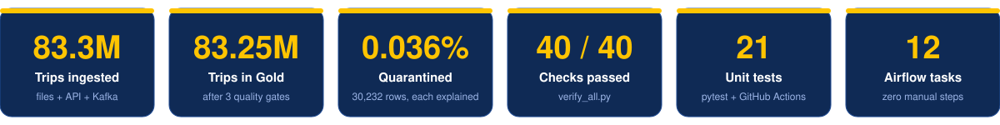
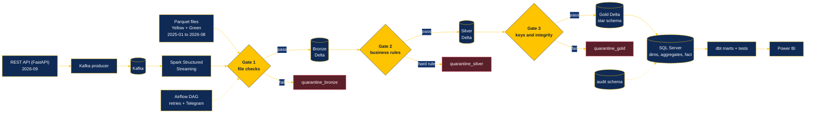
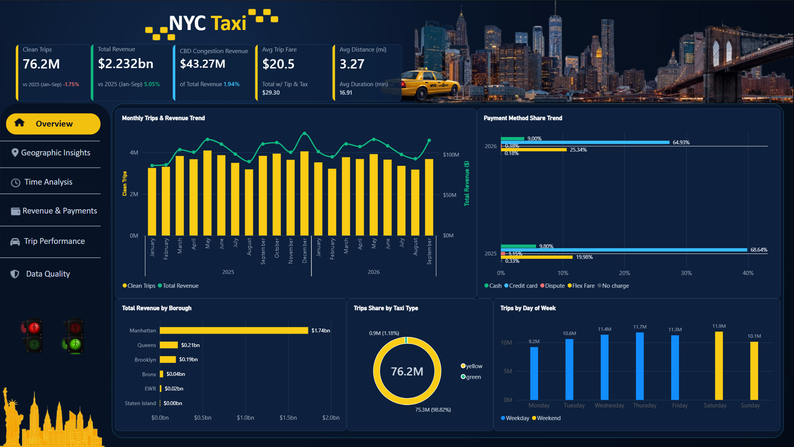
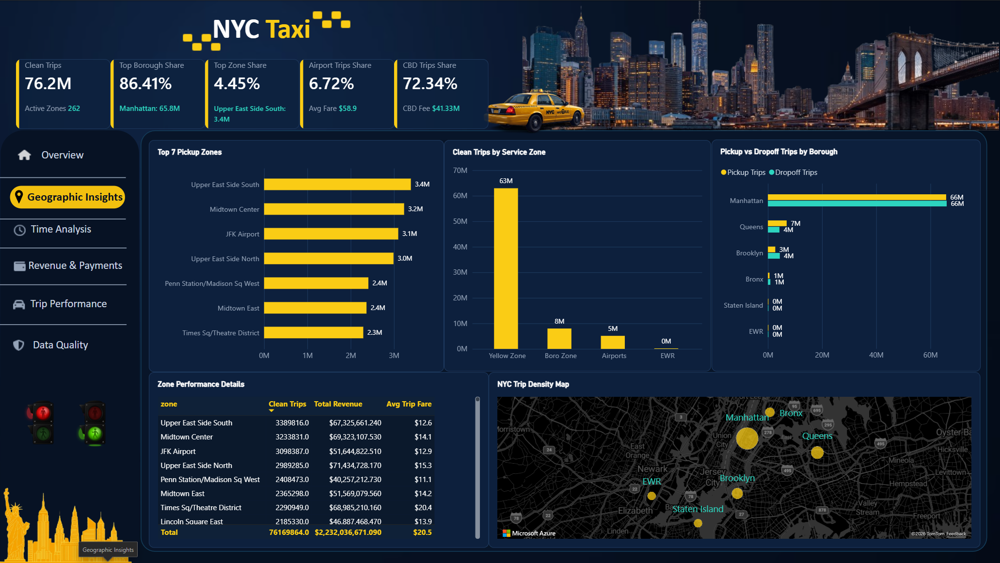
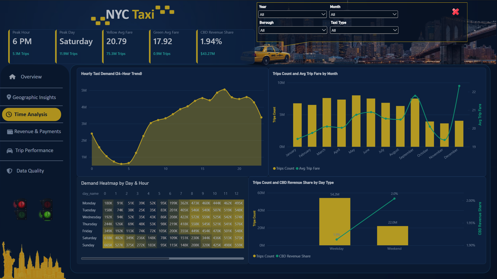

<div align="center">



<br>


<br>


<br><br>



<br><br>

<b>
<a href="#problem">Problem</a> ·
<a href="#architecture">Architecture</a> ·
<a href="#data">Data</a> ·
<a href="#gates">Quality gates</a> ·
<a href="#model">Model</a> ·
<a href="#airflow">Airflow</a> ·
<a href="#dashboard">Dashboard</a> ·
<a href="#run">Run it</a> ·
<a href="#results">Results</a> ·
<a href="#performance">Performance</a> ·
<a href="#checklist">Checklist</a>
</b>

</div>

<br>

An end-to-end data engineering project on **NYC TLC Yellow and Green taxi trips, January 2025 to September 2026**.
It ingests **83.3 million trips** from files and from a live-style REST API and Kafka stream, cleans them through three
quality gates (Bronze, Silver, Gold), loads a star schema into SQL Server, tests it with dbt, and serves a Power BI dashboard.
Airflow runs the whole flow with retries and Telegram alerts. Author: **Abdallah Ali Abdelgawad** (Data Pill graduation project).


<a id="problem"></a>
## 1. The problem

Taxi trip data is large, messy, and arrives in more than one way. This project answers three business questions from it,
and proves every number on the way.

| | Business question | Answered by |
|---|---|---|
| **Q1** | **When and where is taxi demand highest?** (hour, weekday, borough, zone) | `mart_demand_hourly`, `mart_demand_by_zone` |
| **Q2** | **How do payment types and tips differ?** (card tips are recorded, cash tips are not) | `mart_payment_tips` |
| **Q3** | **How do revenue and average fare change over time for Yellow and Green, and what does the new congestion fee (CBD) add?** | `mart_revenue_monthly` |


<a id="architecture"></a>
## 2. Architecture



**Streaming and batch together.** The last month (2026-09, 3.9 million trips) enters through the live path
(API, Kafka, Spark Structured Streaming). All earlier months enter as files. Both paths write into the **same Bronze tables**.
Silver and Gold are incremental batch jobs (micro-batch design): they read only the rows that are new since the last run.


<a id="data"></a>
## 3. Data, profiling and what we found

| Source | Type | Content | Rows |
|---|---|---|---|
| TLC monthly Parquet files (Yellow, Green) | Files (batch) | 2025-01 to 2026-08 | 79,354,446 |
| FastAPI "dispatch" API, then Kafka | REST API and stream | 2026-09 | 3,922,720 |
| `taxi_zone_lookup.csv` | File | 265 taxi zones | 265 |
| **Total trips** | | | **83,277,166** |

**We measured before we designed.** Before building any layer we profiled all 42 files with PyArrow (schemas, row counts) and DuckDB
(nulls, distributions, rule violations). The scripts are in `scripts/`. The rules, limits and reasons are in the
Data Dictionary and Quality Rules document. The findings that shaped the design:

<details>
<summary><b>Click to open the profiling findings</b></summary>

<br>

| Finding | Evidence | What we did |
|---|---|---|
| **Flex Fare trips have a recording pattern** | 20,518,995 Yellow trips (about 25%) have payment type 0. In every one of them, and in no other row, five columns are empty (passenger count, rate code, store-and-forward flag, congestion surcharge, airport fee) | Treated as normal: no flag. Helper column `is_flex_fare` |
| **Negative amounts are common and meaningful** | 3.7% of Yellow trips. 46% of dispute trips and 29% of no-charge trips have a negative fare | Kept and flagged (`has_negative_amount`), never quarantined, money measures exclude them |
| **Some values are impossible** | Maximums of 397,994 miles, 863,372 dollars and 5.3 million mph in a trip | Hard rules with limits from physics and business logic. Percentiles only confirmed the limits |
| **Tips exist for cards only** | The dictionary says cash tips are not recorded | A cash tip of 0 means unknown. Tip analysis uses card trips only |
| **`ehail_fee` (Green) is 100% empty** | 975,165 of 975,165 rows | Kept in Bronze, dropped in Silver |
| **`request_source` is new and undocumented** | Appears from 2026-06, only on Flex Fare trips (4,093,538 rows) | Optional column, kept as it is, meaning not guessed |
| **Zone codes and allowed-value lists are clean** | 0 problems in zone codes, vendor, payment and trip type | Checks stay as a safety net for future and streaming data |
| **`total_amount` does not equal the sum of its parts** | 36% of Yellow and 18% of Green trips differ by more than 5 cents | Too many to be errors, so it is stored for information only (`total_amount_diff`), not used as a rule |

</details>


<a id="stack"></a>
## 4. Technology and why

The full reasoning, with the alternatives we compared, is in [`docs/decisions.md`](docs/decisions.md).

| Area | Tool | Short reason |
|---|---|---|
| Processing | **PySpark 3.5** | Distributed engine for 80+ million rows, native Delta Lake, real streaming |
| Lakehouse | **Delta Lake 3.2** on local disk (ADLS Gen2 ready) | ACID writes, schema evolution, time travel |
| Streaming | **Kafka (KRaft)** + **Spark Structured Streaming** | Second source type and real streaming |
| Source API | **FastAPI** | Simulates a live dispatch system |
| Warehouse and serving | **SQL Server 2022 Developer** | Required warehouse. Columnstore for the 83 million row fact |
| Transformations and tests | **dbt** (`dbt-sqlserver`) | Marts as views and automated data tests |
| Orchestration | **Airflow 2.11** | DAG with dependencies, retries and failure alerts |
| Alerts | **Telegram bot** | Instant failure and success messages |
| Dashboard | **Power BI** | Reads the dbt marts |
| Exploration | **PyArrow, DuckDB** | Fast profiling of 83 million rows without a cluster |
| Infrastructure | **Docker Compose** | One image for all jobs |
| Code quality | **pytest**, **GitHub Actions** | 21 unit tests run on every push |


<a id="gates"></a>
## 5. Medallion layers and the three quality gates

| Layer | What it holds | Gate | A row or file that fails goes to |
|---|---|---|---|
| **Bronze** | Raw columns as they came, plus `taxi_type`, `source_file`, `ingestion_timestamp` | **Gate 1**: file can be read, mandatory columns exist, file not empty. For stream messages: valid JSON with pickup and dropoff time | `quarantine_bronze` (with the reason) |
| **Silver** | Yellow and Green in one schema, lowercase names, calculated columns, stable `trip_id`, exact duplicates removed | **Gate 2**: hard rules (impossible values) quarantine the row. Soft rules (unusual values) only add a flag | `quarantine_silver` (with the reason) |
| **Gold** | Star schema: `fact_trips` and 4 dimensions, plus 2 aggregates | **Gate 3**: every key must exist in its dimension and `trip_id` must be present | `quarantine_gold` |

<details>
<summary><b>Gate 2 rules in short</b> (limits are in <code>config/rules.yml</code>)</summary>

<br>

| Hard rules (row is quarantined) | Soft rules (row stays, flag is added) |
|---|---|
| Dropoff before pickup | Dropoff equal to pickup, trips under 1 minute or over 3 hours |
| Pickup outside 2025-01-01 to 2026-09-30 | Zero passengers, zero distance, distance over 50 miles |
| Duration over 24 hours | Fare equal to 0 or over 300 dollars |
| Passengers over 6 | Speed between 80 and 100 mph |
| Distance over 100 miles | Negative amounts |
| Fare over 1,000 dollars | Cash payment with a tip |
| Speed over 100 mph | CBD fee before its start date (2025-01-05) |
| `total_amount` empty | Airport fee outside an airport zone, pickup month different from the file month, codes outside the allowed lists |

</details>


<a id="model"></a>
## 6. Data model

Star schema with `fact_trips` in the center and four dimensions: `dim_date`, `dim_location`, `dim_payment`, `dim_taxi_type`.
Two aggregate tables (`agg_trips_daily`, `agg_trips_hourly`) feed the dashboard.
Diagram: [`docs/erd_star_schema.md`](docs/erd_star_schema.md). Every table and column is explained in the
**Serving Layer and Gold Model** document.


<a id="airflow"></a>
## 7. Orchestration, monitoring and alerts


* **Airflow DAG `nyc_taxi_pipeline`**: 12 tasks in a line: `check_services`, `bronze_batch`, `producer_api_to_kafka`,
  `stream_into_bronze`, `silver_gate2`, `gold_gate3`, `sync_dims_and_aggregates`, `sync_fact`, `dbt_run`, `dbt_test`,
  `verify_all`, `notify_success`. Each task has 2 retries (2 minutes apart), a 3-hour timeout and a failure alert.
  No manual step is needed, and a re-run is safe because every layer loads only new data.
* **Logging**: every job writes structured log lines (`event=... key=value`).
* **Audit schema in SQL Server**: `audit.pipeline_runs` (one row per run), `audit.step_logs` (rows read, accepted, quarantined,
  seconds and status for every file, slice and micro-batch), `audit.watermarks` (how far each layer has read).
* **Alerts**: a Telegram message on failure and on success. The DAG `telegram_alert_test` fails on purpose to show the alert.
* **Reconciliation**: `verify_all.py` runs 40 checks. Kafka, Bronze, Silver, Gold and SQL Server must agree row by row,
  and the money total must match between the lakehouse and SQL Server.


<a id="dashboard"></a>
## 8. Serving layer and dashboard

Gold lives in the lakehouse. SQL Server holds the dimensions, the two aggregates and the full fact table
(about 3.65 GB as a clustered columnstore). dbt builds four views in schema `dbo_marts`, and Power BI reads those views.
The columns, the definition of every measure and the data caveats are in the **Serving Layer and Gold Model** document.



**Overview page, in numbers** (as shown on the page):

| Clean trips | Total revenue | CBD congestion fee | Average fare | Average distance |
|:---:|:---:|:---:|:---:|:---:|
| **76M** | **$2.23bn** | **$43.27M** (1.94% of revenue) | **$20.5** ($29.30 with tip and tax) | **3.27 mi** (16.9 min) |

<details>
<summary><b>More dashboard pages</b></summary>

<br>

<!-- Add one screenshot per page to docs/images and delete the rows you do not have. -->
<table>
  <tr>
    <td width="50%"></td>
    <td width="50%"></td>
  </tr>
</table>

</details>

**What the data says, and what it does not say**

* From January to September, trips fell 1.75% from 2025 to 2026 while revenue rose 5%. The rise comes from the average fare per trip.
  The data does not tell why the fare rose, so we do not give a cause.
* The CBD congestion fee started on 2025-01-05, so it exists in both compared years. It is a steady source of revenue
  (about 1.9%), not the reason for the growth.
* Flex Fare trips are about 20% of Yellow trips in 2025 and about 25% in 2026 on the payment share chart. They exist from the first month.
* Manhattan holds about three quarters of the revenue (by pickup zone).
* Tip analysis covers card trips only, because cash tips are not recorded.


<a id="tests"></a>
## 9. Testing and CI

* **pytest**: 21 unit tests for the transformation functions (unify, calculated columns, Gate 1, Gate 2, Gate 3, date dimension).
  Run: `docker compose run --rm spark sh -c "pip install -q pytest && python -m pytest tests -v"`.
* **dbt test**: 28 data tests (unique, not null, relationships, accepted values, ranges). The 21 on the dimensions and
  aggregates run inside the DAG. The 7 on the 83-million-row fact are tagged `heavy` and run on demand.
* **GitHub Actions** (`.github/workflows/ci.yml`): installs Java and Spark and runs the unit tests on every push.
* **Gate 1 test**: `src/jobs/gate1_test.py` feeds one good file, one file with a missing column and one corrupt file.
  The job must finish without crashing and send the two bad files to quarantine with the reasons.


<a id="run"></a>
## 10. How to run

**Requirements**: Windows 11, Docker Desktop (WSL2, at least 20 GB for Docker), SQL Server 2022 with SQL authentication and
TCP port 1433, Python 3.11, Git, Microsoft ODBC Driver 18, and the TLC files in one folder (`yellow/`, `green/`, `lookup/`).

1. Clone the repository. Copy `.env.example` to `.env` and fill in the paths, the SQL Server password and (optional) the Telegram token and chat id. `.env` is never committed.
2. In SQL Server run, in this order: `sql/00_setup_database.sql` (and create the login by hand), `sql/01_create_audit_schema.sql`,
   `sql/02_create_watermarks.sql`, `sql/03_create_gold_schema.sql`, `sql/03b_create_gold_aggregates.sql`, `sql/04_create_fact.sql`.
   Run `sql/05_add_fact_foreign_keys.sql` after the first full load.
3. Create the Python environment used by dbt: `python -m venv venv`, activate it, then `pip install -r requirements.txt`.
4. Build and start: `docker compose build` then `docker compose up -d kafka api airflow`.
5. **Run everything with one command:** `.\run_pipeline.ps1`
   (or open Airflow at <http://localhost:8081> and trigger `nyc_taxi_pipeline`).
   Options: `-Reset` wipes the lakehouse and rebuilds from zero, `-Start N` continues from step N, `-FullDbt` also runs the heavy fact tests.
6. Check: `docker compose run --rm spark python -u src/jobs/verify_all.py` (40 of 40 checks must pass).
7. Power BI: connect to SQL Server, database `nyc_taxi_dw`, and import the four views of schema `dbo_marts`.

Secrets live only in `.env` (Airflow reads them as environment variables). Nothing secret is in the code or in Git.


<a id="results"></a>
## 11. Results (measured)

| Layer | Rows |
|---|---|
| Bronze (batch + stream) | **83,277,166** (Yellow 82,302,001, Green 975,165) |
| Silver | **83,246,926** |
| `quarantine_silver` | **30,232** (0.036% of rows) |
| Exact duplicates removed | **8** |
| Gold `fact_trips` | **83,246,926** (Silver = Gold + 0 quarantined) |
| SQL Server `gold.fact_trips` | **83,246,926** |
| Aggregates | 602,330 (daily) and 30,594 (hourly) |

The books close exactly: `83,277,166 = 83,246,926 + 30,232 + 8`. Every quarantine reason count matches the profiling count, and
the money total in SQL Server equals the lakehouse total to the cent (2,372,084,708.13 across all non-negative trips).


<a id="performance"></a>
## 12. Performance and cost

| What | Measurement |
|---|---|
| First Bronze batch load (42 files, 79.35 million rows) | about **154 seconds** |
| Bronze re-run with nothing new (incremental skip) | about **16 seconds** |
| Silver full build (33 Yellow slices, 21 Green slices) | about **33 minutes** (about 70 seconds per monthly Yellow slice) |
| Fact table to SQL Server | about 2.5 minutes per month, about 50 minutes in total |
| SQL Server fact size | **3.65 GB** for 83 million rows (about 182 MB per month). The first month measured 615 MB before compression, so compressing after each month cut the size about **3.4 times** |
| Airflow run with no new data (12 tasks) | about 5.5 minutes |

**Optimizations and why**

1. **Silver in slices.** The first version processed all 82 million rows at once and the Docker engine crashed from memory pressure.
   Processing one ingestion slice at a time keeps memory flat and makes the job resumable: the watermark moves after every slice.
2. **Aggregates for the dashboard.** Power BI does not scan 83 million rows. Time of the same question on the fact versus the aggregate:
   see [`docs/performance_full_run.txt`](docs/performance_full_run.txt).
3. **Columnstore, a 128-bit `trip_key` and no primary key on the fact** keep the table small and the load fast.
4. **Local first, cloud later.** All work ran locally to avoid cloud cost. Switching to Azure only needs new values in `.env`.


## 13. Schema evolution and lineage

**Schema evolution.** From the June 2026 files, a new column `request_source` appeared in both Yellow and Green. The pipeline did not
break: Gate 1 treats it as optional, Delta writes use `mergeSchema`, and Silver keeps the column. Older rows have it empty.

**Lineage.** Every Bronze row carries `source_file` and `ingestion_timestamp`. Silver keeps both and adds a stable `trip_id`.
`audit.step_logs` records, for every file, slice and micro-batch, how many rows were read, accepted and quarantined, and
`audit.watermarks` shows how far each layer has read. The mapping from source columns to Silver columns is in the Quality Rules document (section 5).

## 14. Challenges and how they were solved

| Challenge | Solution |
|---|---|
| The producer sent 1.77 million trips twice (it resumed from a message count) | The producer now refuses to send into a partly filled topic and skips a complete one. Stream writes are idempotent (`txnAppId`, `txnVersion`) |
| Docker crashed during a big Silver run | Slice-based processing and a smaller Spark footprint |
| SQL Server ran out of disk space | Shrunk the log, compressed the columnstore after every month, set a memory limit |
| 83 million rows did not fit comfortably | Columnstore, 128-bit `trip_key`, aggregates for the dashboard |
| Many suspicious values (negative, zero, huge) | Hard and soft rules from the profiling, flags instead of deleting valid refunds |
| The sum check on `total_amount` failed for 36% of trips | Treated as an incomplete formula: kept as information, not as a rule |
| A dimension reload broke after the foreign keys were added | Dimensions are loaded once and never deleted. Only aggregates are refreshed |

## 15. Limitations and future work

* **Azure and Terraform were not executed.** Every path and credential comes from `.env`, so moving the lakehouse to ADLS Gen2 is
  a configuration change. Terraform for the storage account is future work.
* Airflow uses SQLite and one executor: fine for one machine, not for production.
* SQL Server runs on the host (not inside Docker Compose) and its first setup scripts are run by hand.
* Cash tips are not recorded in the source, so tip analysis covers card trips only.
* The meaning of `request_source` is unknown, and the cause of the rise in the average fare is not in the data.

<a id="checklist"></a>
## 16. Requirements checklist

| Requirement | Status |
|---|---|
| Two source types, batch, streaming, over one million rows | ✅ Files, REST API, Kafka. 83.3 million rows |
| Data lake, warehouse, medallion | ✅ Delta lakehouse, SQL Server, Bronze / Silver / Gold |
| Processing tool justified, cleaning, star schema and ERD, incremental load | ✅ |
| Orchestration with dependencies, retries, failure handling, no manual steps | ✅ Airflow |
| Data quality: uniqueness, not null, referential integrity, ranges, quarantine | ✅ 3 gates, 3 quarantine tables, dbt tests |
| Structured logs, alerts, metrics | ✅ Log lines, Telegram, audit tables |
| Docker, secrets in environment, setup explained | ✅ |
| Infrastructure as Code | ⏳ Not done (future work) |
| Git, modular code, unit tests, CI, requirements file | ✅ |
| Dashboard answering three stated questions | ✅ Power BI |
| README, architecture, design decisions, demo | ✅ |
| Streaming and lakehouse, lineage, performance measurements, schema evolution | ✅ |

## 17. Documents

| Document | What it is |
|---|---|
| [`docs/decisions.md`](docs/decisions.md) | Design decisions (ADRs): why each tool, which alternatives |
| [`docs/erd_star_schema.md`](docs/erd_star_schema.md) | Star schema diagram |
| [`docs/performance_queries.md`](docs/performance_queries.md) | Query timing: fact versus aggregate |
| [`docs/demo_script.md`](docs/demo_script.md) | Demo flow and answers to likely questions |
| [`docs/performance_full_run.txt`](docs/performance_full_run.txt) | Timing of each step of `run_pipeline.ps1` |

## 18. Repository structure

```
.
├── airflow/dags/            Airflow DAGs (pipeline and alert test)
├── config/                  sources.yml (sources) and rules.yml (quality limits)
├── dbt/                     dbt project: marts, tests, profile
├── docs/                    decisions, ERD, documents, images
├── scripts/                 profiling scripts (DuckDB, PyArrow)
├── sql/                     SQL Server setup scripts
├── src/
│   ├── api/                 FastAPI dispatch API
│   ├── common/              audit helper (SQL Server logging)
│   ├── jobs/                Bronze, Silver, Gold, sync, check and verification jobs
│   └── streaming/           Kafka producer
├── tests/                   pytest unit tests
├── Dockerfile               Spark, Delta, Kafka and JDBC image
├── Dockerfile.airflow       Airflow, dbt and ODBC on top of it
├── docker-compose.yml
├── run_pipeline.ps1         the one-command runner
└── .env.example             all settings with placeholder values
```

<br>

<div align="center">


<sub>Built with care, one quality gate at a time. NYC TLC data is public.</sub>

</div>
