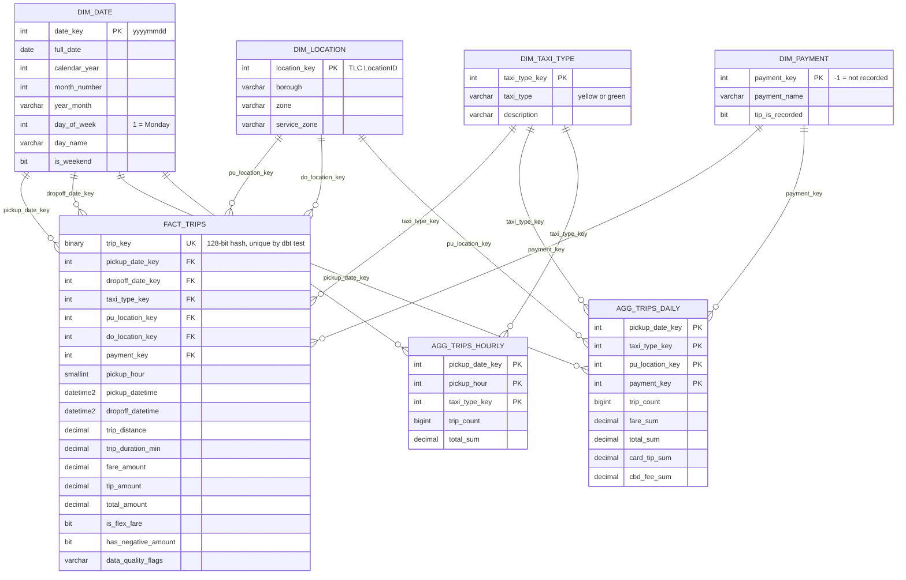

# Star schema (ERD)

Notes: the fact table has about 35 columns (only the main ones are drawn). It has no primary key on purpose
(a key index on 83 million rows is large and slow to load); uniqueness of `trip_key` is proven by a dbt test.